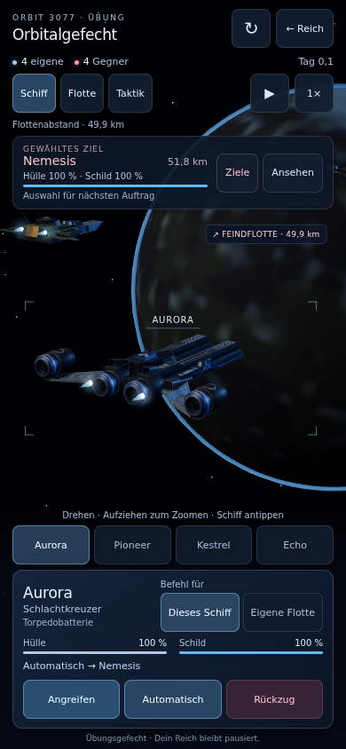
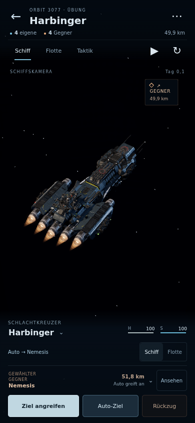

# Harbinger-Grafikprobe · 0.13.0

Dieser Bericht dokumentiert die ursprüngliche Acht-Schiff-Probe. Die aktuelle, skalierbare Gesamtansicht und ihre Bedienung sind in [BATTLE_OVERVIEW.md](BATTLE_OVERVIEW.md) beschrieben; [aktuelle Probeschlacht](https://fabitiko93-cmd.github.io/Browser-Game/battle-overview.html). Die folgenden Aufnahmen und Messwerte sind historische Vergleichswerte.

[Probe öffnen](https://fabitiko93-cmd.github.io/Browser-Game/harbinger.html) · [Vorherige Übung](https://fabitiko93-cmd.github.io/Browser-Game/battle.html)

Die Probe verwendet das bereitgestellte D.S.S. Harbinger-Modell von [Comrade1280](https://sketchfab.com/3d-models/dss-harbinger-battle-cruiser-474f62d00ed54212b37f93ce91569c53), [CC BY 4.0](https://creativecommons.org/licenses/by/4.0/). Geometrie, UVs, Normalen und Materialfaktoren bleiben erhalten. Texturen wurden für mobile Browser aufbereitet: 2K für Farbe/Normalen, 1K für ORM, UASTC/KTX2 mit Mipmaps. 27.675.264 Bytes statt 127.506.300 Bytes, in kleinen Teilen bei Bedarf geladen.

## Tatsächlicher Vergleich

Offizielle Referenzen wurden online geprüft und veröffentlichte Bilder neben unseren echten Browseraufnahmen betrachtet:

- [EVE Evolved: Sharper Skies](https://www.eveonline.com/news/view/eve-evolved-sharper-skies), besonders die aktualisierte Endurance: lesbare Rumpfflächen, lokale Lichtquellen, metallischer Kontrast und zurückhaltender Hintergrund.
- [Homeworld 3: War Games Feedback](https://www.homeworlduniverse.com/war-games-feedback/): geringerer HUD-Platzverbrauch, entfernte Kontakte und klare Bedienung.

| Kriterium | Ergebnis der Probe | Verbleibender Abstand |
| --- | --- | --- |
| Rumpf und Licht | Originalmaterialien, sieben authored Normalmaps, Eigenverschattung, warme Haupttriebwerke an fünf echten Modellöffnungen | Dunkle Harbinger-Flächen trennen sich schwächer als helle Lackflächen der EVE-Referenz. Die Waffen sind im Modell fest eingebaut. |
| Hochformat | 473 statt 321 px freie Kamerahöhe bei 390 × 844: rund 56 statt 38 Prozent | Kleine Statusschrift und begrenzter Raum für umfangreiche Flotteninformationen |
| Befehle | Betrachteter Kontakt, tatsächliches Auto-Ziel und manueller Angriff sind sichtbar getrennt; Empfänger Schiff/Flotte ausdrücklich wählbar | Unterschiedliche Flottenaufträge werden zusammengefasst angezeigt. |
| Taktik | Echte 3D-Positionen, 12,5-km-Raster und antippbare Formationskontakte bei rund 50 km Abstand | Keine vollständige Homeworld-Symbolhierarchie, Höhenanzeigen oder Mehrfachauswahl |
| Flottenqualität | Zwei detaillierte Harbinger-Instanzen, sechs bestehende Begleiter | Quaternius-Begleiter sind deutlich einfacher; ein einheitliches hochwertiges Set fehlt. |

Das ist eine spielbare Verbesserung und **keine Abnahme als AAA-Spiel**. Unterschiedliche Auflösung und Perspektive der Referenzen erlauben keine seriöse Prozentnote für „AAA erreicht“.

## Echte Browseraufnahmen

| Vorher | Neue Probe |
| --- | --- |
|  |  |

[Flotte](review/harbinger-fleet.png), [Taktik](review/harbinger-overview.png), [Gegnerkamera](review/harbinger-target.png), [320 × 568](review/harbinger-small-portrait.png).

Diese Aufnahmen stammen aus dem ausgelieferten WebGL-Spiel. Die [Gefechtsaufnahme](review/harbinger-combat-sample.png) verwendet kontrolliertes Fortschreiten derselben Simulation mit echten Feuer- und Trefferereignissen. Kein Offline-Render und kein FPS-Benchmark.

## Prüfung

`npm run build`, `npm test`: 280 Tests bestanden, `npm run build:check`. Zusätzlich zehn Browser-Prüfgruppen für Originalmaterialien, komprimierte Texturen, echte Auto-/Angriffsaufträge, Kameras, Touch, Grafikmodi, kleines Hochformat, Rückzug, zwei vollständige Neustarts und Offline-Bytebereiche. Keine JavaScript- oder Shaderfehler im geprüften Ablauf.

73.379 Dreiecke im Harbinger-Modell. Im erfassten Nahkamera-Frame 25 Renderaufrufe und 76.303 Dreiecke. 19 komprimierte Texturen; 72.701.776 Bytes Mipdaten im Test, kein Messwert für gesamten GPU-Speicher. Die Ressourcenanzahl blieb nach zwei Neustarts gleich.

[Maschinenlesbares Protokoll](review/browser-inspection.json). Wiederholen mit `ORBIT_BROWSER_EXECUTABLE=/pfad/zu/chrome node scripts/qa-harbinger.mjs`; optional `ORBIT_QA_BASE_URL` für die öffentliche Seite und `ORBIT_QA_OUTPUT_DIR` für getrennte Testausgaben.

Gemessen wurde in Chrome mit ANGLE/SwiftShader. Die Leistung auf dem tatsächlichen iPhone und längere Sitzungen bleiben zu prüfen. Das Grafikmenü zeigt im laufenden Gefecht eine gemessene Bildrate, bei Pause ausdrücklich „Pausiert“.
